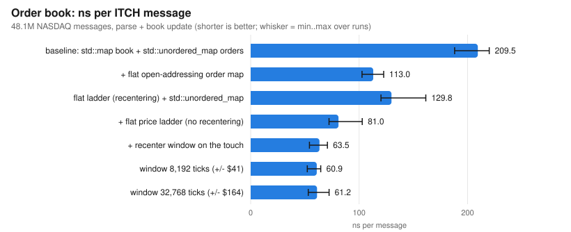
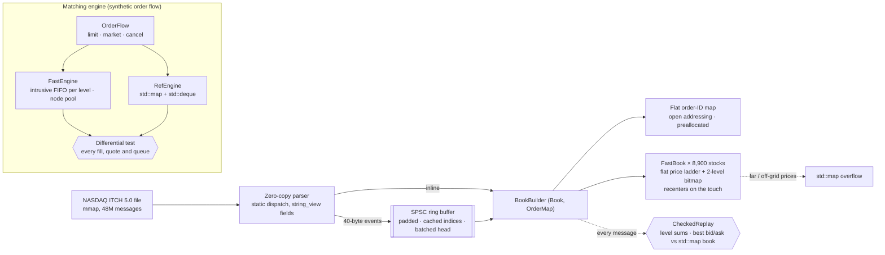

# itch-lob

A low-latency order book and matching engine in C++20. It rebuilds every NASDAQ stock's full depth-of-book from real **TotalView-ITCH 5.0** market data, checks the result after every message, and measures what each optimization buys.

## Results

<!-- results:begin -->

| Component | Result |
|---|---|
| ITCH 5.0 parser (zero-copy) | 223M msgs/s, 6.9 GB/s, 4.5 ns/msg |
| Order book replay (parse + book) | 18.9M msgs/s, **3.49×** the std::map baseline |
| Book latency per message | p50 125 ns, **p99 417 ns**, p99.9 1167 ns |
| Matching engine (price-time) | 86.2M orders/s, 11.6 ns/order, 4.87× the reference |
| Two-thread SPSC pipeline | 13.9M msgs/s; queue adds 83 ns at p50 |
| Correctness | 50.9M per-message level checks and 46.5M best bid/ask checks, 0 mismatches; 10/10 randomized engine seeds × 1M orders identical to the reference |

Input: 48.1M messages of real NASDAQ data (12/30/2019 sample). Full tables, ablations and latency plots: [`results/REPORT.md`](results/REPORT.md).



**Resume bullet:**

> Replayed 48.1M NASDAQ ITCH 5.0 messages at 18.9M msgs/s with 417 ns p99 latency, 3.5× faster than a std::map baseline, using a flat price ladder and a lock-free SPSC queue.

<!-- results:end -->

## Architecture



The book side replays real data. ITCH is already-matched exchange output, so the **matching engine** runs on its own deterministic random order flow and is verified against a reference engine.

## Design

**Parser** (`include/itch/`). The file is `mmap`ed and read as `[u16 length][message]` frames. Integers are decoded with one unaligned load and a byte swap, and symbols are `std::string_view`s into the mapping, so nothing is copied or allocated. Handlers are plain structs called through a template, with no virtual calls; unused message types compile to nothing. Each frame's length is checked against the spec, and a truncated tail reports where to resume.

**Order book** (`include/lob/`). `BookBuilder<Book, OrderMap>` applies add, execute, cancel, delete and replace. The same code runs every variant, so the ablation isolates the data structures:
- `MapBook` + `StdOrderMap`: the baseline. `std::map` per side and `std::unordered_map` for orders.
- `FlatOrderMap`: open addressing with linear probing and Fibonacci hashing over one preallocated array. Deletion is backward-shift, so there are no tombstones.
- `FastBook`: a flat array of price levels per stock, so a price lookup is a subtraction and a constant divide. A two-level bitmap finds the next best level with `clz`/`ctz`. Prices outside the window, or off the tick grid, go to a `std::map` overflow, so the book is always exact. Pre-market stub quotes can anchor the window far from the real market, so the book **recenters on the touch** when the best bid or ask leaves the window. Ladders are `mmap`ed, so a wide window costs RAM only where orders rest. The window size is a build option, chosen by the ablation's sweep.

**Matching engine** (`include/engine/`). Price-time priority for limit, market and cancel orders. `FastEngine` keeps one level per tick, each an intrusive doubly-linked FIFO of nodes from a preallocated pool, so add, fill and cancel-from-the-middle are all O(1). A two-level bitmap finds the next price across a 65,536-tick band, and order id → node is a flat map. Nothing is allocated after construction. Pool size matters: once the id map outgrows cache, cost per order nearly doubles (see the capacity sweep in the report).

**Pipeline** (`include/pipeline/`). A parser thread and a book thread joined by a lock-free single-producer single-consumer ring: power-of-two slots, monotonically increasing 64-bit indices, acquire/release only. Three optimizations, each switchable for the ablation:
- 128-byte cache-line padding between producer state, consumer state and slots.
- Each side caches the other's index and rereads it only when the queue looks full or empty.
- The consumer publishes its read position every 32 pops instead of every pop.

**Benchmarks** (`include/bench/`, `tools/`). Runs are repeated, interleaved across variants, and reported as median and range. Latency uses the CPU counter (`cntvct_el0` on arm64, `rdtscp` on x86) into an exact histogram, plotted HdrHistogram-style. On Linux, `perf_event_open` adds IPC, branch and cache misses; on every platform, `getrusage` adds context switches and page faults.

## Correctness

- **Book replay.** After every message, each changed price level is compared, shares and order count, with a separately maintained level-sum table, and each stock's best bid and ask with a reference `std::map` book. A final audit rebuilds every level from the live orders. Every book variant must produce identical final books. Unit tests show the checker catches a book that drops a share or keeps a stale best bid.
- **Matching engine.** Every random order goes to both engines. Results, the exact fill sequence (taker, maker, price, qty) and best quotes are compared after every order, and both full books, queue order included, every 10K orders. Invariants are checked too: the book never crosses, and shares are conserved. A mutation test that fills the newest order first is caught on the first affected order.
- **Pipeline.** Every two-thread run is hashed and must match the single-thread books. ThreadSanitizer finds no data races.
- **Unit tests.** 63 GoogleTest tests, built and run on Apple clang 17, clang 18 and gcc 13, also under AddressSanitizer and UBSan.

## Reproduce

Requires CMake ≥ 3.20 and a C++20 compiler. GoogleTest is fetched automatically.

```bash
cmake -S . -B build -DCMAKE_BUILD_TYPE=Release   # add -DITCH_LADDER_WINDOW=8192 to change the book window
cmake --build build -j
ctest --test-dir build --output-on-failure

scripts/fetch_sample.sh 12302019 1.5   # streams NASDAQ's 12/30/2019 file, keeps a 1.5 GB slice
scripts/run_all.sh                     # every check and benchmark (10-15 min) -> results/*.json, REPORT.md, this README
```

Individual tools:

| Tool | What it does |
|---|---|
| `itch_stats FILE` | parse throughput and message counts |
| `book_replay FILE --check` | replay with per-message verification (map and fast books) |
| `book_replay FILE --latency` | per-message latency histograms |
| `ablation FILE` | every book variant and window size, interleaved, median and range |
| `engine_bench` | 10 × 1M-order differential test, throughput, capacity sweep, latency |
| `pipeline_bench FILE [--rate M]` | inline vs pipeline, queue ablation, paced end-to-end latency |
| `gen_synthetic OUT` | deterministic synthetic ITCH feed (no download needed) |
| `python3 scripts/report.py` | rebuild `results/REPORT.md`, the plots and the results block above |

## Limitations

- **Timer resolution.** Apple Silicon's user-readable counter advances in about 41.7 ns steps, so single-message percentiles below that are quantized. p99.9 and above are meaningful.
- **macOS scheduling.** macOS has no hard thread pinning and doesn't expose hardware counters without Instruments or root. Involuntary context switches, which the tools count, cause the pipeline's p99.9 tail. On Linux with isolated cores most of it would go away.
- **Data.** The book is rebuilt from one trading day's first 1.5 GB, about 48M messages. The matching engine uses synthetic order flow, because ITCH contains executions, not the incoming orders behind them.

## Layout

```
include/itch/      endian  messages  parser  encoder  synthetic  mapped_file
include/lob/       map_book  fast_book  order_map  book_builder  checker
include/engine/    types  ref_engine  fast_engine  order_flow  diff
include/pipeline/  spsc_queue  pipeline  cpu
include/bench/     latency  counters  stats
tools/             itch_stats  itch_slice  gen_synthetic  book_replay  ablation  engine_bench  pipeline_bench
tests/             test_parser  test_book  test_fast_book  test_engine  test_pipeline
scripts/           fetch_sample.sh  run_all.sh  report.py
results/           JSON from every run, REPORT.md, plots/*.svg
```
