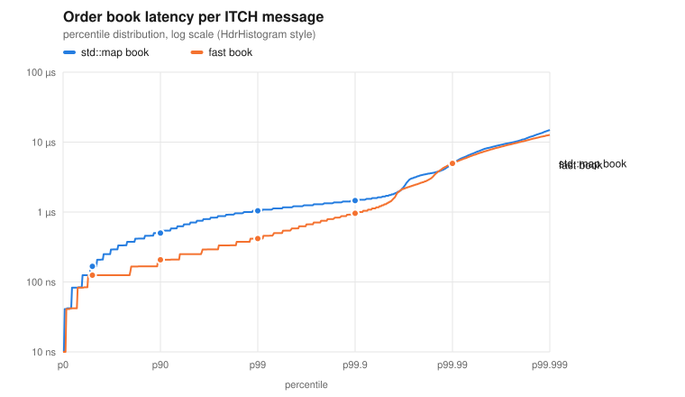
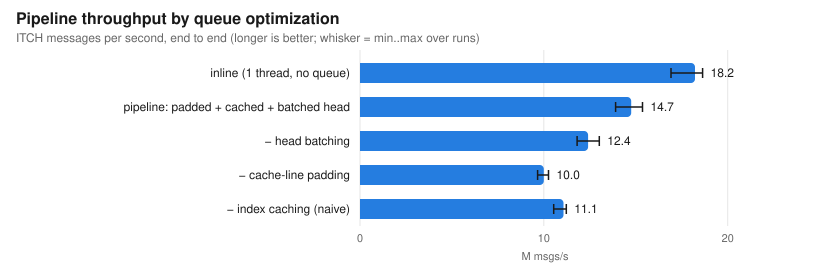
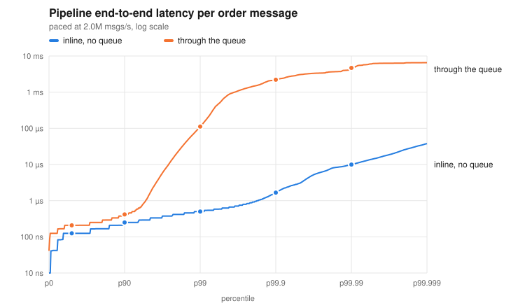

# Benchmark report

Generated by `scripts/report.py` from `results/*.json`. Regenerate everything with `scripts/run_all.sh`.

Input: NASDAQ TotalView-ITCH 5.0, 48.06M messages.

## Correctness

| Check | Result |
|---|---|
| Parser framing | ok, 48,058,456 messages |
| std::map book vs independent level sums | passed: 50,894,699 per-message level checks, 46,533,368 best bid/ask checks, 735,322-level final audit, 0 mismatches |
| fast book vs independent level sums | passed: 50,894,699 per-message level checks, 46,533,368 best bid/ask checks, 735,322-level final audit, 0 mismatches |
| All book variants build the same final books | yes |
| Matching engine vs reference (randomized) | 10/10 seeds × 1,000,000 orders, 2,435,548 fills compared |
| Two-thread pipeline builds the same books as one thread | yes |

## Order book: what each optimization bought

Each variant replays the full file; 5 interleaved runs, median and range of ns per message (parse + book update).

| Variant | ns/msg (median) | Range | vs baseline | vs previous step | M msgs/s | adds to overflow | ladder RAM |
|---|---|---|---|---|---|---|---|
| baseline: std::map book + std::unordered_map orders | 184.5 | 174.7 – 185.0 | 1.00× | — | 5.4 | — | — |
| + flat open-addressing order map | 101.1 | 98.0 – 102.7 | 1.82× | 1.82× | 9.9 | — | — |
| flat ladder (recentering) + std::unordered_map | 120.8 | 119.8 – 128.1 | 1.53× | 1.53× | 8.3 | 2,183,479 | 433 MB of 437 MB reserved |
| + flat price ladder (no recentering) | 73.0 | 72.6 – 75.6 | 2.53× | 1.39× | 13.7 | 9,321,606 | 425 MB of 437 MB reserved |
| + recenter window on the touch | 54.7 | 54.4 – 56.9 | 3.37× | 1.33× | 18.3 | 2,183,479 | 433 MB of 437 MB reserved |
| window 8,192 ticks (+/- $41) | 52.8 | 52.1 – 54.5 | 3.49× | 1.04× | 18.9 | 839,327 | 720 MB of 1311 MB reserved |
| window 32,768 ticks (+/- $164) | 54.6 | 53.6 – 55.3 | 3.38× | 1.00× | 18.3 | 560,032 | 912 MB of 4808 MB reserved |

“vs previous step” follows baseline → flat orders → flat ladder → recenter; the window rows compare against the 2,048-tick recentering book; “flat ladder + std::unordered_map” isolates the ladder alone. Ladders are mmap'd, so a wide window reserves address space but only touched pages use RAM (measured with `mincore`).

Fastest window: **8,192 ticks** (52.8 ns/msg, 839,327 overflow adds). Build with it: `cmake -S . -B build -DITCH_LADDER_WINDOW=8192`.

Hardware counters: not available on this machine. On Linux, `ablation` reads cycles, instructions, branch and cache misses through `perf_event_open`; macOS exposes them only to Instruments or to root via the private kperf framework, and most VMs don't expose them at all.

## Order book latency per message

Each message timed individually (parse + book update), including timer overhead.

| Book | mean | p50 | p90 | p99 | p99.9 | p99.99 | max |
|---|---|---|---|---|---|---|---|
| std::map | 257 | 167 | 542 | 1166 | 2042 | 14125 | 91,552,200 |
| fast | 114 | 125 | 208 | 417 | 1167 | 6125 | 498,507 |

Clock resolution 41 ns: every sample is a multiple of it, so percentiles below about 41 ns are not meaningful.

## Matching engine

10,000,000 random orders (4,852,031 limit, 299,937 market, 4,848,032 cancel), 1,726,652 fills.

| Engine | M orders/s | ns/order | M fills/s |
|---|---|---|---|
| reference (std::map + std::deque) | 17.70 | 56.5 | 3.06 |
| fast | 86.23 | 11.6 (11.5 – 11.9) | 14.89 |

Speedup 4.87×. Per-order latency (fast): p50 41 ns, p99 83 ns, p99.9 125 ns, p99.99 167 ns (clock resolution 41 ns).

Order-pool capacity vs cost per order. The id map is 2× capacity × 16 B; once it outgrows cache, every lookup misses:

| Capacity | id map | ns/order (median) |
|---|---|---|
| 16,384 | 0.5 MB | 11.6 |
| 65,536 | 2.1 MB | 11.7 |
| 262,144 | 8.4 MB | 12.2 |
| 1,048,576 | 33.6 MB | 18.7 |

## Two-thread pipeline

Parser thread → SPSC ring (4096 × 40 B) → book thread; 3 interleaved runs, placement: qos=user-interactive.

| Variant | M msgs/s (median) | Range | vs inline |
|---|---|---|---|
| inline (1 thread, no queue) | 19.43 | 17.01 – 19.55 | 1.00× |
| pipeline: padded + cached + batched head | 16.31 | 16.10 – 16.37 | 0.84× |
| − head batching | 13.49 | 13.48 – 13.52 | 0.69× |
| − cache-line padding | 10.90 | 10.77 – 10.92 | 0.56× |
| − index caching (naive) | 11.76 | 11.59 – 11.82 | 0.61× |

End-to-end latency at 1.0M msgs/s, paced (producer late for 0.07% of sends):

| Path | p50 | p90 | p99 | p99.9 | p99.99 |
|---|---|---|---|---|---|
| inline, no queue | 125 | 167 | 333 | 792 | 3,934 |
| through the queue | 209 | 333 | 542 | 4,185 | 38,851 |

During the paced run: 341 involuntary and 0 voluntary context switches. Each involuntary switch stalls a spinning thread for microseconds and shows up directly in the p99.9+ tail. macOS has no hard core pinning, so these can't be eliminated there.

## Headline numbers

- Messages replayed: **48.1M**
- Fast book throughput (parse + book): **18.9M msgs/s** (52.8 ns/msg)
- Fast book p99 per message: **417 ns** (p99.9 1167 ns)
- Speedup over std::map baseline: **3.49×**
- Build: 8,192-tick price window
- Parser alone: **223M msgs/s** (6.9 GB/s)
- Matching engine: **86.2M orders/s**, 4.87× the reference, 10/10 randomized seeds passed

## Resume bullet

> Replayed 48.1M NASDAQ ITCH 5.0 messages at 18.9M msgs/s with 417 ns p99 latency, 3.5× faster than a std::map baseline, using a flat price ladder and a lock-free SPSC queue.
