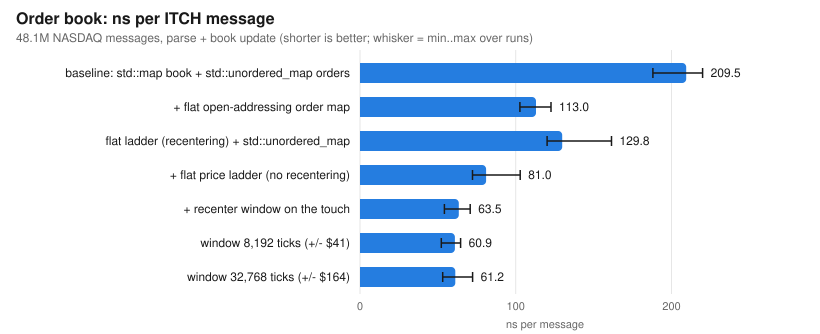
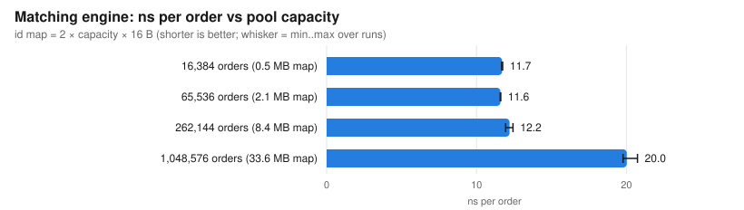
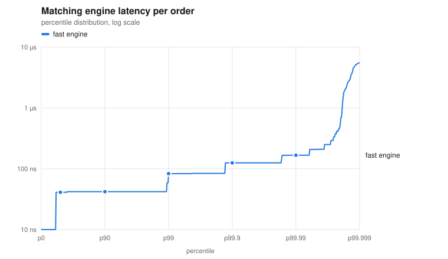

# Benchmark report

Generated by `scripts/report.py` from `results/*.json`. Regenerate everything with `scripts/run_all.sh`.

Input: NASDAQ TotalView-ITCH 5.0, 48.06M messages.

## Correctness

| Check | Result |
|---|---|
| Parser framing | ok, 48,058,456 messages |
| std::map book vs independent level sums | passed: 50,894,699 per-message level checks, 46,533,368 best bid/ask checks, 735,322-level final audit, 0 mismatches |
| fast book vs independent level sums | passed: 50,894,699 per-message level checks, 46,533,368 best bid/ask checks, 735,322-level final audit, 0 mismatches |
| All book variants build the same final books | yes |
| Matching engine vs reference (randomized) | 10/10 seeds × 1,000,000 orders, 2,435,548 fills compared |
| Two-thread pipeline builds the same books as one thread | yes |

## Order book: what each optimization bought

Each variant replays the full file; 5 interleaved runs, median and range of ns per message (parse + book update).

| Variant | ns/msg (median) | Range | vs baseline | vs previous step | M msgs/s |
|---|---|---|---|---|---|
| baseline: std::map book + std::unordered_map orders | 206.7 | 169.7 – 209.1 | 1.00× | — | 4.8 |
| + flat open-addressing order map | 113.5 | 96.8 – 117.6 | 1.82× | 1.82× | 8.8 |
| flat ladder (recentering) + std::unordered_map | 134.1 | 116.5 – 145.2 | 1.54× | 1.54× | 7.5 |
| + flat price ladder (no recentering) | 80.1 | 72.1 – 82.9 | 2.58× | 1.42× | 12.5 |
| + recenter window on the touch (final) | 58.5 | 56.0 – 63.8 | 3.53× | 1.37× | 17.1 |

“vs previous step” follows baseline → flat orders → flat ladder → recenter; “flat ladder + std::unordered_map” isolates the ladder alone.

Without recentering, 9,321,606 adds land in the std::map overflow; with it, 2,183,479 (3,062 recenters).

Hardware counters: not available on this machine. On Linux, `ablation` reads cycles, instructions, branch and cache misses through `perf_event_open`; macOS exposes them only to Instruments or to root via the private kperf framework, and most VMs don't expose them at all.

## Order book latency per message

Each message timed individually (parse + book update), including timer overhead.

| Book | mean | p50 | p90 | p99 | p99.9 | p99.99 | max |
|---|---|---|---|---|---|---|---|
| std::map | 239 | 166 | 500 | 1042 | 1458 | 4916 | 93,331,900 |
| fast | 114 | 125 | 208 | 417 | 958 | 4958 | 911,403 |

Clock resolution 41 ns: every sample is a multiple of it, so percentiles below about 41 ns are not meaningful.

## Matching engine

10,000,000 random orders (4,852,031 limit, 299,937 market, 4,848,032 cancel), 1,726,652 fills.

| Engine | M orders/s | ns/order | M fills/s |
|---|---|---|---|
| reference (std::map + std::deque) | 17.25 | 58.0 | 2.98 |
| fast | 85.89 | 11.6 (11.5 – 16.2) | 14.83 |

Speedup 4.98×. Per-order latency (fast): p50 41 ns, p99 83 ns, p99.9 125 ns, p99.99 209 ns (clock resolution 41 ns).

Order-pool capacity vs cost per order. The id map is 2× capacity × 16 B; once it outgrows cache, every lookup misses:

| Capacity | id map | ns/order (median) |
|---|---|---|
| 16,384 | 0.5 MB | 11.7 |
| 65,536 | 2.1 MB | 11.6 |
| 262,144 | 8.4 MB | 12.2 |
| 1,048,576 | 33.6 MB | 20.0 |

## Two-thread pipeline

Parser thread → SPSC ring (4096 × 40 B) → book thread; 5 interleaved runs, placement: qos=user-interactive.

| Variant | M msgs/s (median) | Range | vs inline |
|---|---|---|---|
| inline (1 thread, no queue) | 18.22 | 16.91 – 18.63 | 1.00× |
| pipeline: padded + cached + batched head | 14.75 | 13.90 – 15.36 | 0.81× |
| − head batching | 12.41 | 11.81 – 13.02 | 0.68× |
| − cache-line padding | 10.00 | 9.66 – 10.25 | 0.55× |
| − index caching (naive) | 11.07 | 10.54 – 11.22 | 0.61× |

End-to-end latency at 2.0M msgs/s, paced (producer late for 0.49% of sends):

| Path | p50 | p90 | p99 | p99.9 | p99.99 |
|---|---|---|---|---|---|
| inline, no queue | 125 | 167 | 334 | 708 | 1,416 |
| through the queue | 209 | 333 | 3000 | 289,951 | 1,357,374 |

During the paced run: 14,671 involuntary and 0 voluntary context switches. Each involuntary switch stalls a spinning thread for microseconds and shows up directly in the p99.9+ tail. macOS has no hard core pinning, so these can't be eliminated there.

## Headline numbers

- Messages replayed: **48.1M**
- Fast book throughput (parse + book): **17.1M msgs/s** (58.5 ns/msg)
- Fast book p99 per message: **417 ns** (p99.9 958 ns)
- Speedup over std::map baseline: **3.53×**
- Parser alone: **224M msgs/s** (7.0 GB/s)
- Matching engine: **85.9M orders/s**, 4.98× the reference, 10/10 randomized seeds passed
